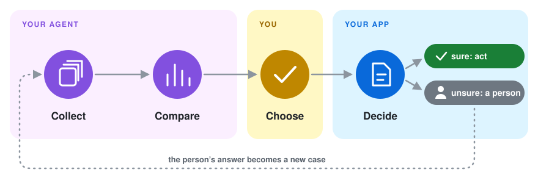
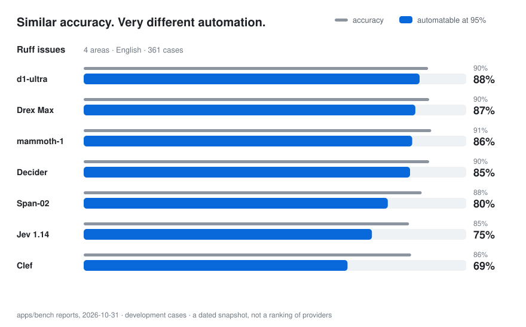

<div align="center">
  <h1>s1flow</h1>
  <p><strong>Evaluate decision models on your own data, then ship the one you trust.</strong></p>
  <p>
    Decision models such as Jev, Clef, d1 and OpenAI's Decisions API (also called System One models)
    answer a typed question, like yes/no or pick one, with a probability instead of free text.
    s1flow measures on your own labeled cases how much work each model can take over at the accuracy you need,
    then runs that setup in your app.
  </p>
  <p><em>Is this ticket a bug? Which team owns it? Should the agent act or ask?</em></p>
  <p><a href="#quick-start">Quick start</a> · <a href="docs/README.md">Docs</a> · <a href="apps/bench/reports">Benchmarks</a></p>
</div>

<picture>
  <source media="(prefers-color-scheme: dark)" srcset="docs/images/how-it-works-dark.svg">
  
</picture>

## Accuracy hides what you can automate

<picture>
  <source media="(prefers-color-scheme: dark)" srcset="docs/images/automation-share-dark.svg">
  
</picture>

These four models are within 9 points of each other on accuracy, yet the share of cases each can handle while
staying 95% accurate ranges from 0% to 97%, and the leader flips between tasks. Claude Haiku 4.5, an LLM asked
once per case, gives every answer the same confidence, so no threshold gets it to 95%. The numbers are a snapshot
of four of the 13 to 21 models in the [reports](apps/bench/reports), not a ranking of providers. Your own cases
may tell a different story, which is exactly why you measure them.

## Quick start

**1. Install the CLI.** You need Python 3.13 or later.

```bash
uv tool install "s1flow[eval]"
```

**2. Add the s1flow Skill to your coding agent.**

| Agent | How |
|---|---|
| Claude Code | `/plugin marketplace add gotalab/s1flow`, then `/plugin install s1flow@s1flow` |
| Codex | `codex plugin marketplace add gotalab/s1flow`, then install s1flow from the Plugins directory |
| Cursor and other agents | `s1flow skill install` copies the Skill into `.agents/skills/` and `.claude/skills/` |

Plugins update through your agent's plugin manager. `s1flow skill install` copies the files into your
repository instead, so they change only when you run it again.

**3. Tell your agent what to decide, in your own words.**

> *Use s1flow to decide whether a new GitHub issue is a bug. Call the task is-bug, collect 200 labeled issues, compare the models and show me the result.*

The agent runs `s1flow init`, which creates an `s1flow/` folder and touches nothing else in your repository.
The default line-up needs one key, `OPENROUTER_API_KEY`, and fetching issues needs the `gh` CLI, signed in.
A CI check on pull requests is one flag away (`s1flow init --ci`) when you want it.

**4. Run your pick in your app.** Your choice is saved as a *policy*: one JSON file holding the model, the
question and the confidence threshold. Your app needs only the base package (`pip install s1flow`), which depends
on just httpx and pydantic, plus a `connections.toml` that lists the models it is allowed to call, including the
one the policy uses ([format](docs/app.md#your-first-decision)).

```python
from s1flow import Client, policies

client = Client(connections="connections.toml")
policy = policies.load(path="s1flow/policies/is-bug/v1.json", client=client)
decision = policy.decide({"text": "Crash on startup"})
decision.value, decision.probability   # True, 0.93
```

No labels yet? You can [ship a policy today](docs/app.md) and evaluate it later.

## What you get

- **A comparison you can act on.** Pull cases from GitHub issues, app logs or labels you already have, and run every model and prompt against them. For each one you see how much it can handle at your target accuracy, with confidence intervals, cost and latency.
- **What runs is what you measured.** A policy pins the model, prompt and threshold you evaluated. Change any of them, or the cases, and the old results no longer apply to it.
- **A CI check on every policy change.** A GitHub Action tests the new policy against the current one on the test cases and posts the result on the pull request.
- **All the major decision models, plus LLMs for comparison.** Jev (TypeSafe), Clef (Cloudflare), d1 (Liquid) and pplx-decider (Perplexity) through the System One API or OpenRouter, OpenAI's Decisions API, LLMs through LiteLLM, or a provider you write yourself.
- **Production feedback becomes new cases.** Record the correct answer for a decision ID, and it goes into the next comparison.

## Docs

| Page | What it covers |
|---|---|
| [Run decisions in your app](docs/app.md) | your first policy, the SDK, calling a model directly |
| [Evaluate and compare](docs/evaluate.md) | cases, `report`, charts, thresholds |
| [Policies, evidence and releases](docs/policies.md) | versions, evidence, releasing with a pull request, schemas |
| [Feedback and improvement](docs/feedback.md) | recording correct answers, measuring in production, prompt optimization |
| [Connections and discovery](docs/connections.md) | which models your app may call, and how config files are found |
| [CLI, agents and CI](docs/cli-and-ci.md) | exit codes, the Agent Skill, GitHub Actions |
| [Develop s1flow](docs/development.md) | running this repository's checks |
